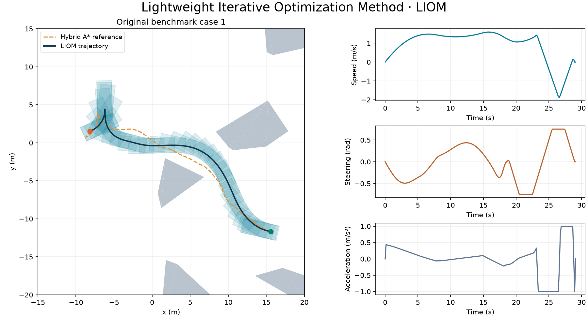
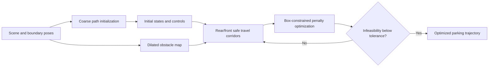

# Parking Motion Planning with a Lightweight Iterative Framework

[Download ZIP](https://github.com/libai1943/ParkingMotionPlanningTITS21/archive/refs/heads/main.zip) · [Getting started](#matlab-start-with-one-case) · [Guide](#function-and-file-map) · [Citation](#citation)

**Turn a coarse parking route into an optimized, collision-free maneuver.** This repository accompanies *Optimization-Based Trajectory Planning for Autonomous Parking With Irregularly Placed Obstacles: A Lightweight Iterative Framework*, published in **IEEE Transactions on Intelligent Transportation Systems**, 23(8), 11970–11981, 2022. The DOI and repository name reflect the paper's 2021 online publication.



The image is generated from an actual C++ solve of original benchmark **case 1**. The dashed curve is the newly searched initialization; translucent rectangles show the optimized vehicle footprints.

## How the planner works

The MATLAB framework combines **fault-tolerant hybrid A*** initialization with the **Lightweight Iterative Optimization Method (LIOM)**. A pair of circles covers the rectangular vehicle body. Rectangular safe travel corridors are constructed for their centers on a dilated obstacle map.

LIOM solves an intermediate problem with simple box constraints. Nonlinear kinematic and geometric equalities, together with the terminal-heading condition, enter a squared-residual penalty. After each solve, the trajectory is used to rebuild the corridors. Iteration stops when the infeasibility measure meets the acceptance tolerance.



The original MATLAB planner and AMPL model remain in the repository root. A standalone C++/CasADi example is in [cpp/](cpp/).

## MATLAB: start with one case

Use **Windows MATLAB**, **Image Processing Toolbox** for map dilation, and a toolbox installation supporting the planner's Reeds–Shepp/hybrid-A* initialization. Several algorithm and visualization helpers are supplied as executable MATLAB P-code. AMPL and an AMPL-compatible IPOPT are invoked through local files and command-line calls.

1. Download the full repository, including `ParkingBenchmarks/`, the `.p` helpers, and the solver executables/DLLs.
2. Open MATLAB in the repository root.
3. In `RunMe.m`, replace the default `for ii = 1 : 115` loop with `for ii = 1` for a single example.
4. Run:

```matlab
cd('C:/path/to/ParkingMotionPlanningTITS21');
RunMe;
```

The unmodified entry point runs **all 115 benchmarks**. Select another existing case by changing the loop value. `params_.user.case_id` passes that value to the protected case loader.

The Windows solver distribution must be usable under its own license and support the model size. Keep matching DLLs beside the solver. If using an external AMPL/IPOPT installation, ensure it is visible to MATLAB's system calls. No MATLAB/AMPL API binding is required. Native Linux/macOS MATLAB deployment is not supplied by the bundled Windows executables.

## C++: install, build, and run

The C++ example performs **hybrid A* initialization, reference resampling, iterative corridor construction, and LIOM optimization**. It uses CasADi/IPOPT and does not require MATLAB or AMPL. The sampled hybrid-A* initializer is a compact replacement for the MATLAB FTHA component; the full FTHA fallback implementation is not reproduced in C++.

Install:

- A **C++17** compiler and **CMake ≥3.16**.
- **CasADi**, including its C++ headers, CMake configuration, and IPOPT plugin.
- The appropriate shared-library runtime for your CasADi distribution.

See [CasADi's official installation instructions](https://github.com/casadi/casadi/wiki/InstallationInstructions) and [documentation](https://web.casadi.org/docs/).

```bash
cmake -S cpp -B build -DCMAKE_BUILD_TYPE=Release -Dcasadi_DIR=/path/to/casadi/cmake
cmake --build build --config Release
./build/liom_demo --output results_cpp
```

Windows with MinGW-w64 and a compatible CasADi distribution:

```powershell
$env:PATH = "C:\path\to\casadi;C:\path\to\mingw64\bin;" + $env:PATH
cmake -S cpp -B build -G "MinGW Makefiles" -Dcasadi_DIR=C:/path/to/casadi/cmake
cmake --build build
.\build\liom_demo.exe --output results_cpp
```

Use `PATH` on Windows or `LD_LIBRARY_PATH` on Linux to expose the CasADi shared libraries. The supplied protected search binaries target x86-64; the Windows DLL is copied beside the executable during the build. Windows/MinGW execution with CasADi 3.7.2 is verified; the Linux search library is cross-compiled and has not been runtime-tested here.

The default IPOPT linear solver is **MUMPS**. Optional HSL usage requires a separately installed compatible library, `HSL_LIBRARY` pointing to it, and `--linear-solver ma27`.

### Inputs, outputs, and acceptance

`cpp/data/` contains case 1's endpoint poses, obstacle geometry, and dilated occupancy map. It does **not** contain a precomputed trajectory. Every invocation searches and optimizes afresh.

The executable writes `trajectory.csv` with columns `t,x,y,theta,v,a,phi,omega`, and `reference.csv` with the initial geometric route. It prints each LIOM iteration's infeasibility and objective. Before reporting success, it verifies the hard bounds and independently checks the actual covering discs against the obstacles at all 200 configuration points.

The C++ penalty objective and discretization follow the repository's `NLP.mod`, including its backward-Euler residuals and terminal-heading sine/cosine penalty. The continuous model and LIOM iteration correspond to the paper; the discrete convention is the one used by this MATLAB release. Search initialization and sparse linear solver can produce different local optima.

### Read the case 1 result

A successful C++ run writes two files to the directory passed to `--output`. Open them side by side to see what the optimization changed.

| File | What to plot | Question it answers |
| --- | --- | --- |
| `reference.csv` | `x` against `y` | Where does the geometric initialization pass the obstacles? |
| `trajectory.csv` | `x` against `y` with equal axes | Which parts of the route moved during corridor refinement? |
| `trajectory.csv` | `v` and `phi` separately against `t` | Where does the vehicle reverse, and how does it steer through each turn? |

The final console line reports `Tf` in seconds, the number of LIOM iterations, covering-disc clearance in metres and elapsed planning time in seconds. Use `Tf` to compare maneuver duration. Use the elapsed planning time to compare computation on the same hardware. The clearance value comes from the discrete 200-node check in [the C++ validator](cpp/src/main.cpp).

## Main parameters

| Setting | Default |
| --- | ---: |
| Configuration points | 200 |
| Wheelbase / front overhang / rear overhang / width | 2.8 / 0.96 / 0.929 / 1.942 m |
| Speed / acceleration limits | ±2.5 m/s / ±1 m/s² |
| Steering / steering-rate limits | ±0.75 rad / ±0.5 rad/s |
| Corridor expansion step / maximum per side | 0.1 m / 2 m |
| Penalty weight | 100,000 |
| Infeasibility tolerance | 0.0001 |
| Maximum LIOM iterations | 5 |
| Acceleration / steering / steering-rate cost weights | 0.025 / 0.00083983 / 0.0051 |

MATLAB settings are in `InitializeParams.m`; C++ settings are explicit in `cpp/src/main.cpp` and `planning.hpp`. A successful IPOPT solve alone is not the LIOM stopping criterion: the softened-equality infeasibility must also pass.

## Function and file map

| File | Responsibility |
| --- | --- |
| `RunMe.m` | Select benchmark IDs and run initialization followed by LIOM. |
| `InitializeParams.m` | Load the case, define vehicle/planner settings, build maps, and write basic model parameters. |
| `LoadCase.p` | Protected loader for the selected benchmark. |
| `SearchTrajectoryViaFTHA.p`, `SearchAStarPath.p` | Protected coarse-search components. |
| `ResamplePath.p`, `ResampleCollocationPoints.p`, `FormInitialGuessViaFullConfig.p` | Prepare reference states, controls, and the optimization warm start. |
| `ConstructSafeTravelCorridors.p` | Protected front/rear corridor generation. |
| `OptimizeTrajectoryViaLIOM.p` | Protected MATLAB LIOM solve/rebuild/accept loop. |
| `WriteBasicParameterFile.m`, `WriteBoundaryValues.m` | Write numerical model inputs. |
| `NLP.mod`, `rr.run`, `ipopt.opt` | Penalty formulation, AMPL solve/output commands, and IPOPT settings. |
| `CreateVehiclePolygon.m`, `RegulateAngle.m` | Vehicle footprint construction and angle handling. |
| `DrawParkingScenario.p`, `DrawTrajFootprints.p`, `GenerateGifForLimo.p`, `asd.p`, `SaveFigure.m` | Original drawing, animation, and figure-saving helpers. |
| `ParkingBenchmarks/` | 115 original parking scenes. |
| `cpp/src/planning.hpp` | Scene reader, protected-search interface, resampling, and corridor expansion. |
| `cpp/src/main.cpp` | CasADi penalty model, LIOM iteration, validation, and numerical output. |
| `cpp/lib/` | Protected geometric-search libraries and component notice. |

## Citation

Please cite the paper when using the method, code, or benchmark scenes:

```bibtex
@article{Li2022LightweightParking,
  author = {Bai Li and Tankut Acarman and Youmin Zhang and Yakun Ouyang
            and Cagdas Yaman and Qi Kong and Xiang Zhong and Xiaoyan Peng},
  title = {Optimization-Based Trajectory Planning for Autonomous Parking
           With Irregularly Placed Obstacles: A Lightweight Iterative Framework},
  journal = {IEEE Transactions on Intelligent Transportation Systems},
  volume = {23}, number = {8}, pages = {11970--11981}, year = {2022},
  doi = {10.1109/TITS.2021.3109011}
}
```

[Read the paper](https://doi.org/10.1109/TITS.2021.3109011). See [LICENSE](LICENSE) for repository terms. External solvers and runtime libraries retain their own licenses.
